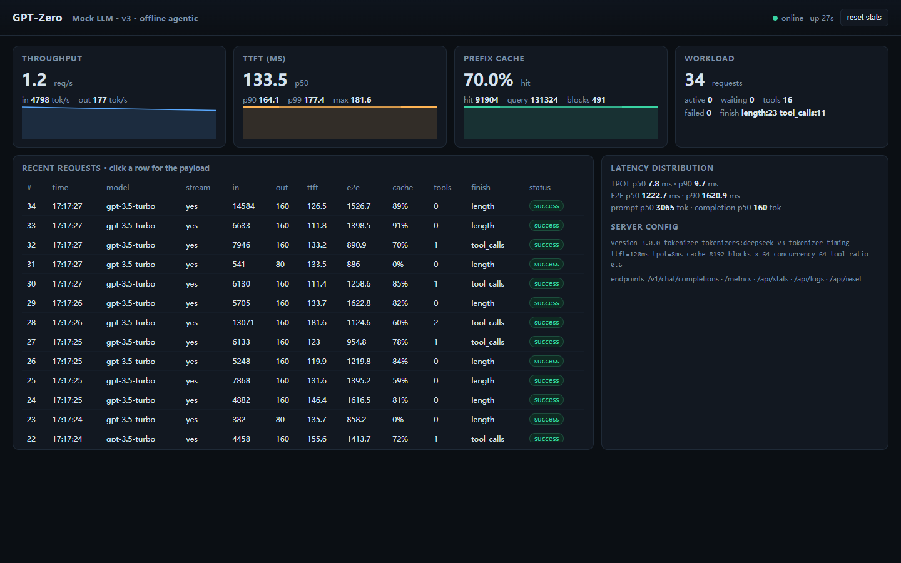

# GPT-Zero · offline multi-protocol mock LLM

[](https://github.com/Potterluo/GPT-Zero/actions/workflows/ci.yml)
[](https://pypi.org/project/openai-mock/)
[](https://github.com/Potterluo/GPT-Zero/pkgs/container/gpt-zero)
[](https://potterluo.github.io/GPT-Zero/)
[](LICENSE)

一个**纯离线**的 Mock 推理服务：一套引擎同时支持 **OpenAI Chat Completions / OpenAI Responses / Anthropic Messages** 三种调用形式（JSON + SSE），每个协议都有真实的 **fake 工具调用**，外加增长的超长上下文、64-token 块的 prefix cache、vLLM 风格 Prometheus 指标、开箱即用的压测脚本与图表。

> 它**不是**模型，不产生有意义的回答。它复现的是**可观测行为**：token 计数、TTFT/TPOT、排队、缓存命中、工具调用帧、成功率——让推理栈、网关、调度器、监控面板在没有 GPU 的环境里也能被压测和回归。
>
> 协议适配的形态参考了 [deepseek-recipe](https://github.com/deepseek-ai/deepseek-recipe) 的 server 示例（一个后端同时服务 `/v1/chat/completions`、`/v1/responses`、`/v1/messages` 三种格式）：这里只取它的「协议转换 + 流式/完整响应」思路，不做 tokenizer 转换/编码那部分。

```
                 ┌────────────────────────────────────────────┐
   agent loop ──▶│  /v1/chat/completions   OpenAI Chat        │
                 │  /v1/responses          OpenAI Responses   │──▶ SSE / JSON
                 │  /v1/messages           Anthropic Messages │   （工具调用、精确 token 数）
                 ├────────────────────────────────────────────┤
                 │  protocols: 三协议 ↔ 内部表示 的双向适配     │
                 ├────────────────────────────────────────────┤
                 │  engine: prefix cache    │──▶ 64-token 块哈希 + LRU 序列淘汰
                 │          timing model    │──▶ TTFT = 未命中 prefill + 排队
                 ├────────────────────────────────────────────┤
                 │  /metrics  /api/stats    │──▶ vLLM 命名计数器 + 分位数统计
                 └────────────────────────────────────────────┘
```

## v4 做了什么（相对 v3）

| 能力 | v3 | v4 |
|---|---|---|
| 调用形式 | 仅 OpenAI Chat Completions | **+ OpenAI Responses API、+ Anthropic Messages API**（JSON/SSE 双模式） |
| 工具调用 | OpenAI `tool_calls` | 三协议原生形态：Chat `delta.tool_calls`、Responses `function_call` + `function_call_arguments.delta`、Messages `tool_use` + `input_json_delta`（id 为 `toolu_*`） |
| 多轮上下文 | 客户端回填历史 | 同左，Responses 另有 `previous_response_id` 服务端链式上下文 + `GET /v1/responses/{id}` |
| AgentX 配套 | `agentx/` trace 生成 + 回放、`agentx_offline/` 镜像 | **整体移除**（mock 功能保持完整） |
| 回复内容 | 确定性 filler，精确按 `max_tokens` 产出 | 同左 |
| 延迟/缓存/指标 | TTFT/TPOT 模型 + prefix cache + Prometheus | 同左，三协议同口径统计 |

## 快速开始

=== 三种安装方式

**pip**（PyPI 包名 `openai-mock`，import 名仍是 `gptzero`）：

```bash
pip install openai-mock
gptzero --port 8090 --tokenizer deepseek_v3_tokenizer
```

**Docker**（GHCR 多架构镜像，amd64/arm64）：

```bash
docker run --rm -p 8090:8090 ghcr.io/potterluo/gpt-zero:latest
```

**源码**（开发模式，离线可用：依赖只在本地 venv / 镜像里）：

```bash
python -m venv .venv
.venv\Scripts\pip install -e ".[dev]"      # Windows
# source .venv/bin/activate && pip install -e ".[dev]"   # Linux/macOS

# 2) 启动 mock（8090 只是示例端口；本机 8080 可能被其它服务占用）
.venv\Scripts\python server.py --port 8090 --tokenizer deepseek_v3_tokenizer
```

```bash
# 3) 冒烟
curl http://127.0.0.1:8090/health
curl -X POST http://127.0.0.1:8090/v1/chat/completions \
  -H "Content-Type: application/json" \
  -d '{"model":"gpt-3.5-turbo","messages":[{"role":"user","content":"hi"}],"max_tokens":32}'
```

打开 <http://127.0.0.1:8090/> 看实时面板；`/metrics` 给 Prometheus 抓；`/api/stats` 给脚本读。



### 关键参数

| 参数 | 默认 | 作用 |
|---|---|---|
| `--ttft-ms` / `--tpot-ms` | 180 / 8 | 首 token 基础延迟、每 token 解码时间 |
| `--jitter` | 0.12 | 延迟相对抖动（0 = 完全确定） |
| `--prefill-tps` | 0 | >0 时 TTFT 由**未命中** token 数 / 该速率决定（缓存收益可见） |
| `--max-concurrency` | 64 | 同时在处理的请求数，超出排队（排队时间计入 TTFT） |
| `--cache-blocks` / `--block-size` | 8192 / 64 | prefix cache 容量与块大小 |
| `--tool-call-ratio` | 0.6 | 带 tools 的轮次触发工具调用的概率 |
| `--tokenizer` | auto | `auto` 找仓库内 `deepseek_v3_tokenizer/`，否则 heuristic |
| `--log-file` | 空 | 每请求 JSONL 落盘 |

所有参数支持 `GPTZERO_*` 环境变量（如 `GPTZERO_PORT=8090`），CLI 优先。

## 三种调用形式

### OpenAI Chat Completions — `POST /v1/chat/completions`

```bash
curl -X POST http://127.0.0.1:8090/v1/chat/completions \
  -H "Content-Type: application/json" \
  -d '{
    "model": "gpt-3.5-turbo",
    "messages": [{"role": "user", "content": "read src/engine.py"}],
    "tools": [{"type": "function", "function": {
      "name": "read_file",
      "parameters": {"type": "object", "properties": {"path": {"type": "string"}}, "required": ["path"]}}],
    "max_tokens": 64, "stream": false
  }'
```

返回标准 `choices[0].message.tool_calls`（`id` 为 `call_*`、`arguments` 是合法 JSON），`finish_reason="tool_calls"`；把 `role=tool` 结果回填后再请求，得到普通文本收尾。`stream=true` 时参数按 24 字符切片从 `delta.tool_calls[].function.arguments` 流出。

### OpenAI Responses — `POST /v1/responses`

```bash
curl -X POST http://127.0.0.1:8090/v1/responses \
  -H "Content-Type: application/json" \
  -d '{
    "model": "gpt-4.1",
    "instructions": "You are a coding agent.",
    "input": [{"type": "message", "role": "user", "content": "read src/engine.py"}],
    "tools": [{"type": "function", "name": "read_file",
               "parameters": {"type": "object", "properties": {"path": {"type": "string"}}, "required": ["path"]}}],
    "tool_choice": "required",
    "max_output_tokens": 64
  }'
```

- 返回标准 `response` 对象：文本在 `output[].type="message"` 的 `output_text` 里，工具调用是 `output[].type="function_call"`（`call_id/name/arguments`）。
- mock 无自然 EOS：纯文本轮 `status="incomplete"` + `incomplete_details={"reason":"max_output_tokens"}`；工具轮 `status="completed"`。
- `stream=true` → `event: response.created` → `output_item.added` → `output_text.delta` / `function_call_arguments.delta` → `response.completed`（或 `response.incomplete`），帧带 `sequence_number`。
- 服务端存最近响应：`GET /v1/responses/{id}` 可取回；带上 `previous_response_id` + `function_call_output` 即可走服务端多轮链路（上下文计入 token 与前缀缓存，命中率随轮次上升）。

### Anthropic Messages — `POST /v1/messages`

```bash
curl -X POST http://127.0.0.1:8090/v1/messages \
  -H "Content-Type: application/json" \
  -H "anthropic-version: 2023-06-01" \
  -d '{
    "model": "claude-3-5-sonnet",
    "max_tokens": 64,
    "system": [{"type": "text", "text": "You are a mock.", "cache_control": {"type": "ephemeral"}}],
    "messages": [{"role": "user", "content": "read src/engine.py"}],
    "tools": [{"name": "read_file", "input_schema": {
      "type": "object", "properties": {"path": {"type": "string"}}, "required": ["path"]}}],
    "tool_choice": {"type": "any"},
    "stream": false
  }'
```

- 返回标准 `message` 对象：`content` 里是 `text` / `tool_use` 块（`tool_use.id` 为 `toolu_*`、`input` 是 JSON 对象），`stop_reason` ∈ `tool_use|max_tokens|stop_sequence`。
- 工具结果用 `user` 消息里的 `tool_result` 块回填（mock 会把它转成 `role=tool`），下一轮得到纯文本，agent 循环正常终止。
- `stream=true` → `message_start` → `ping` → `content_block_start/delta/stop`（文本 `text_delta`、工具参数 `input_json_delta`）→ `message_delta` → `message_stop`，与 Anthropic 官方事件序一致。

> 三个协议共用同一套引擎与指标：`tool_choice` 语义互通（`required` / 指定函数 / `any` 强制调用，`none` 强制不调用），token 计数、前缀缓存、TTFT/TPOT 完全同口径。

## 压测：一条命令出表 + 出图

```bash
# 闭环并发扫点（chat / coding / agentic / longctx 四种 profile）
.venv\Scripts\python -m bench sweep ^
  --url http://127.0.0.1:8090 ^
  --profiles chat,coding,agentic ^
  --concurrency 1,2,4,8,16 ^
  --duration 15 --name sweep_mock_a

# 只重画/重生成报告（从 JSON）
.venv\Scripts\python -m bench report results/sweep_mock_a.json
```

产物：

```
results/sweep_mock_a.json     自包含原始摘要（config + 每个并发点）
results/sweep_mock_a.md       中文表格：TTFT p50/p90/p99、TPOT、E2E、RPS、tok/s、cache hit、成功率
results/sweep_mock_a.csv
results/charts/*.png / *.svg  TTFT、吞吐、缓存命中、CDF、Pareto、profile 对比
```

指标口径：TTFT 从发出请求到**第一个含 content/tool_calls 的 delta**；TPOT = `(e2e-ttft)/(completion_tokens-1)`；缓存命中率取服务端计数器**差分**（token 级，不是请求级）。

已跑出的真实结果（表格 + 图表 + 读法与复现命令）：**[results/README.md](results/README.md)**。

- `sweep_mock_a`（ttft=120ms / tpot=8ms / 64 槽位）：并发 1→16，RPS 0.63→10.12，TPOT 稳定 7.4–8.5ms，缓存命中 70.8–87.3%；
- `sweep_mock_b`（ttft=400ms / tpot=18ms / 8 槽位）：并发 16 超过槽位，TTFT p50 从 ~450ms 跳到 **3935ms**、RPS 停在 2.0 —— 复现“容量拐点”；
- `sweep_profiles`：同并发下 chat / coding / agentic 的差异，coding 缓存命中 97.6%、agentic 70.7%。

## Docker（纯离线）

```bash
docker build -t gptzero:v4 .
docker run --rm --network none gptzero:v4 smoke          # 容器内自检
docker run --rm -p 8090:8090 gptzero:v4 mock             # 起 mock
docker run --rm --network none -v %cd%/results:/app/results gptzero:v4 bench sweep --concurrency 1,2,4
```

离线交付：`scripts/offline_image.ps1` 负责 build + `docker save` 到 `dist/gptzero-v4.tar`，目标机器 `docker load` 即用。细节见 `docs/DOCKER.md`。

## 发布（PyPI / GHCR / Pages）

一次 tag push 三产物，全自动（详见 [docs/RELEASE.md](docs/RELEASE.md)）：

| 产物 | 触发 | 地址 |
|---|---|---|
| PyPI 包 `openai-mock` | `git tag v4.0.1 && git push origin v4.0.1` | [pypi.org/project/openai-mock](https://pypi.org/project/openai-mock/) |
| GHCR 镜像 `:版本` + `:latest`（amd64/arm64） | 同上 | `ghcr.io/potterluo/gpt-zero` |
| 文档站（mkdocs-material） | push main / 手动触发 | [potterluo.github.io/GPT-Zero](https://potterluo.github.io/GPT-Zero/) |

发布前的一次性配置（Pages 开启、PyPI Trusted Publishing）也写在 `docs/RELEASE.md`。

## 仓库结构

```
gptzero/           mock 服务（app / protocols / engine / tokenizer / metrics / dashboard）
bench/             闭环压测 harness（client / workload / runner / aggregate / report / charts）
docs/              ARCHITECTURE.md · BENCHMARK.md · DOCKER.md · RELEASE.md（= Pages 站点源）
tests/             server 契约测试 + 三协议契约测试 + bench 单测
scripts/           离线镜像、容器 smoke、CI 辅助
.github/workflows/ ci.yml（PR 门禁）· pages.yml（文档站）· release.yml（tag → PyPI + GHCR）
mkdocs.yml         文档站配置（mkdocs-material + mermaid）
Dockerfile         python:3.11-slim 多阶段、非 root、运行期零网络
```

## 兼容性

- v2/v3 的全部端点保留：`/`（面板）、`/v1/chat/completions`、`/v1/completions`、`/v1/models`、`/health`、`/api/logs`、`/api/log/{id}`、`/api/config`、`/api/stats`、`/api/models*`、`/api/tokens`。旧的 `assets/dashboard.html` 仍可通过 `/legacy` 打开。
- v4 新增：`/v1/responses`（POST + GET）、`/v1/messages`。

## 测试

```bash
.venv\Scripts\python -m pytest -q
```

## 已知限制（请如实引用）

- mock 的吞吐上限是**单机 Python event loop**，不是 GPU；高并发下 CPU 先饱和，不代表真实服务端能力。
- 长上下文有 CPU 成本：176k token 的 prompt 首次编码约 **290ms**，之后走编码缓存约 **20ms**/请求（块哈希 + 计数）。这是 mock 的开销，报告解读时要扣除。
- Windows 上默认定时器精度 ~15.6ms 会让 8ms 的 TPOT 被放大到 ~15.7ms 或偶发提前返回；`server.py` 启动时会调用 `timeBeginPeriod(1)`（日志行 `timer : 1ms high-resolution timer enabled`），**看到这行才代表 TPOT 可信**。Linux 无此问题。
- filler 文本无语义；没有 EOS，因此 Chat 的 `finish_reason=length`、Responses 的 `status=incomplete`、Messages 的 `stop_reason=max_tokens` 是纯文本轮的**常态**，不要据此判断截断缺陷。
- prefix cache 是**块级模拟**，不含真实 KV 显存/调度器行为；`kv_cache_usage_perc` 是块占用比例。
- 协议覆盖以「调用都能正确返回」为目标：不实现多模态内容（图片只忽略）、`web_search`/`computer_use` 等非函数工具、`response_format` 约束解码与 logprobs。

## License

Apache-2.0（见 [LICENSE](LICENSE)）。协议适配形态参考 [deepseek-recipe](https://github.com/deepseek-ai/deepseek-recipe)（MIT）。
