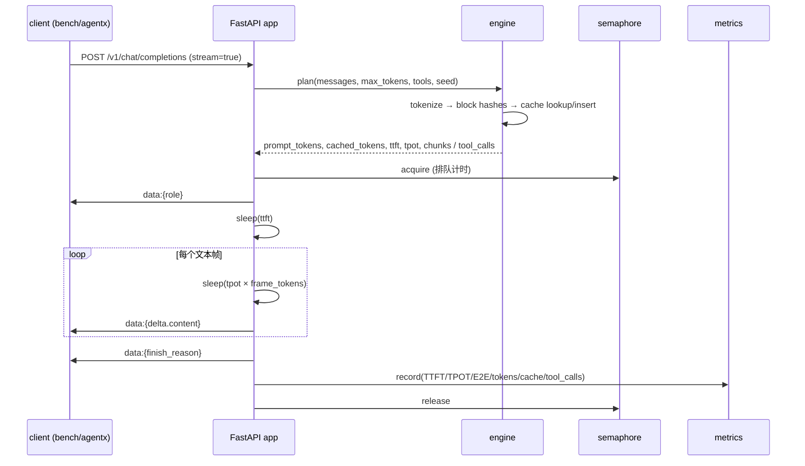

# 架构与实现说明

## 1. 组件

```
                    ┌─────────────┐
   HTTP (SSE/JSON)  │  gptzero    │
  ─────────────────▶│  .app       │ FastAPI 路由：OpenAI 兼容 + 观测端点 + 面板
                    └──────┬──────┘
                           │ plan()
                    ┌──────▼──────┐
                    │  engine     │ 前缀缓存 + 输出生成 + 延迟模型
                    └──┬───────┬──┘
              tokenize │       │ metrics
                    ┌──▼──┐  ┌─▼────────┐
                    │tok. │  │ metrics  │ 计数器/直方图/分位数
                    └─────┘  └──────────┘
                           │
                    ┌──────▼──────┐
                    │ dashboard   │ 轮询 /api/stats + /api/logs
                    └─────────────┘
```

| 模块 | 责任 | 关键点 |
|---|---|---|
| `gptzero/app.py` | HTTP 层、SSE、并发闸门、请求日志 | 一个请求只解析一次 body；槽位等待时间计入 TTFT |
| `gptzero/engine.py` | `PrefixCache`、`Filler`、`LatencyModel`、`MockEngine.plan()` | 纯函数式计划，流式/非流式共用同一份结果 |
| `gptzero/tokenizer.py` | token 计数/编解码 | 优先 `tokenizers` 读 `tokenizer.json`（decode 保留空格），回退启发式 |
| `gptzero/metrics.py` | 计数器、直方图、Prometheus 文本 | 分位数用保留样本精确算，桶仅用于 Prometheus |
| `gptzero/models.py` | 本地模型目录扫描/模糊匹配 | v2 兼容，只用于找 tokenizer |
| `bench/` | 闭环压测、聚合、报告、图表 | 只走 HTTP，与服务端解耦 |
| `agentx/` | WEKA trace 生成、DAG 回放 | 主链 + 子代理 SPAWN/JOIN |

## 2. 一次请求的生命周期



非流式路径相同，只是把帧合并成一次 sleep：

```
sleep(ttft + tpot × (completion_tokens − 1)) → 一次性 JSON
```

## 3. 延迟模型

```
未命中 token 数 U = prompt_tokens − cached_tokens

若 prefill_tps > 0:   prefill_ms = U / prefill_tps × 1000
否则:                 prefill_ms = ttft_ms × (1 + U/8192)^0.6

TTFT   = base + prefill_ms + queue_wait      (+ seeded gaussian jitter)
每 token = tpot_ms  或 1000/decode_tps       (+ jitter)
```

- `queue_wait`：`--max-concurrency` 构成的信号量；排队时间直接叠加到客户端观测的 TTFT。
- 抖动：`N(value, jitter×value)` 截断到 ≥0，随机源由 `seed ^ hash(model, prompt_tokens)` 决定 → 同请求可复现。
- 这一模型让「prefix cache 命中」既能体现在计数器，也能体现在 TTFT（配置 `--prefill-tps` 时）。

### 3.1 计时精度（Windows 实测）

mock 的解码步长常为个位数毫秒，而 Windows 默认定时器粒度约 15.6ms：`asyncio.sleep(0.008)` 可能被放大到 15.7ms，或在事件循环繁忙时提前返回，直接污染 TPOT 口径。两层处理：

1. `gptzero/app.py::_pace()`：以 `time.perf_counter()` 的绝对 deadline 循环补睡，提前唤醒会被补上；
2. `gptzero/cli.py`：Windows 启动时 `winmm.timeBeginPeriod(1)`（退出时 `timeEndPeriod(1)`），把粒度降到 1ms；启动日志出现 `timer : 1ms high-resolution timer enabled` 才说明生效。

实测：`--tpot-ms 8` 下 50 token 流式 e2e=529ms（理论 512ms），服务端 TPOT p50=6.9ms。

## 4. 前缀缓存模拟

- 把 prompt 编码成 token id 序列，按 `block_size`（默认 64，与 AgentX 的 64-token 块一致）切块，块哈希 = `blake2b(ids[64])`。
- 查询：沿 trie 走，返回最长**完整块**前缀的 token 数。
- 插入：整条序列插入，块引用计数 +1；同一序列重复出现时刷新 LRU 次序。
- 淘汰：容量（块数）超限时淘汰最久未使用的**序列**，引用计数归零的块才真正释放——共享 system 前缀不会因为某个会话结束而被踢掉。
- 对外指标：`vllm:prefix_cache_queries_total` / `hits_total` / `evictions_total`，以及 `kv_cache_usage_perc = 存活块 / 容量`。

> 这是**语义级**模拟（ClawPerf 的 trie 思路一致），不模拟显存碎片、block table、swap。

## 5. 工具调用合成

1. 若 `tools` 为空，或最后一条消息是 `role=tool` → 走文本回复（agent 循环得以终止）。
2. 否则按 `sha256(seed, model, prompt)` 抽签（`--tool-call-ratio`）。
3. 工具名：从 `tools` 里按 hash 轮转；参数：按 JSON Schema 的 `required` 与 `type` 造值（string 类型的 path/command/content 有真实感）。
4. `parallel_tool_calls=true` 时按概率追加第二个调用。
5. 流式：首帧给 `id/type/name`，随后按 24 字符切分 `arguments` 片段；`finish_reason=tool_calls`。
6. 统计：`gptzero:tool_calls_total{name}` 与 `/api/stats.tool_calls`。

## 6. 指标口径

| 指标 | 定义 | 用途 |
|---|---|---|
| TTFT | 发出请求 → 首个 content/tool_calls delta | 交互性主指标（AgentX 也以此为核心） |
| TPOT | `(e2e − ttft) / (completion_tokens − 1)` | 解码速度 |
| ITL | 相邻内容帧间隔均值 | 流式平滑度 |
| E2E | 请求全程 | 容量/超时预算 |
| cache hit rate | `hits_total / queries_total`（token 级差分） | 判断前缀复用是否真生效 |
| RPS / tok/s | 完成数、输入/输出 token 数 ÷ 墙钟 | 吞吐 |
| queue | 槽位等待时间 | 区分「服务慢」与「排队慢」 |

`/api/stats` 给 p50/p90/p99/mean/max；`/metrics` 用固定桶（TTFT 1ms…300s）以兼容 Prometheus 抓取。

## 7. 压测 harness 设计（bench）

```
workload.py  生成会话脚本（profile + seed）→ 每会话一串 turn
runner.py    闭环：N 个协程各跑一条会话；每 turn 记录 TTFT/ITL/E2E
             warmup 期间丢弃样本；结束后读 /api/stats + /metrics 差分
aggregate.py 分位数、RPS、tok/s、命中率、成功率
report.py    JSON → Markdown / CSV / 图（matplotlib Agg）
```

- **闭环**而非固定批次：一条会话的下一 turn 依赖上一 turn 完成，和真实 agent 一致；并发提高时完成的请求数自然增加。
- 每个并发点前后各取一次服务端计数器，避免跨点污染。
- 图表默认英文标签，避免无中文字体的容器里出现方块。

## 8. AgentX 对应关系

| AgentX 机制 | 本仓库实现 | 说明 |
|---|---|---|
| `--concurrency N` 闭环 lane | `bench`/`agentx replay` 的 N 条会话协程 | 语义一致：并发的是客户端 |
| WEKA trace `hash_ids`（64-token 块） | `agentx/trace_gen.py` + `PrefixCache` 块哈希 | 前缀共享可被服务端真实命中 |
| `t` 时间轴 + 子代理 SPAWN/JOIN | `agentx/replay.py` | 主链等待 JOIN，子链并发 |
| `max_tokens=out` + `ignore_eos` | 服务端精确产出 `out` token | 长度可比 |
| warmup：primer + 10 条/lane | replay 的 warmup 阶段 | 建立 KV 前缀后再计量 |
| `cache_bust=FIRST_TURN_PREFIX` | `[rid:xxxxxxxxxxxx]` 注入首轮 | 防止跨 replay 复用 |
| 报告：throughput + TTFT + interactivity | bench 报表/图 | 不产出官方 submission |

不能复现的部分（真实模型质量、厂商 chat template、speculative acceptance、HF 数据集内容）见 `docs/AGENTX.md` §10。
