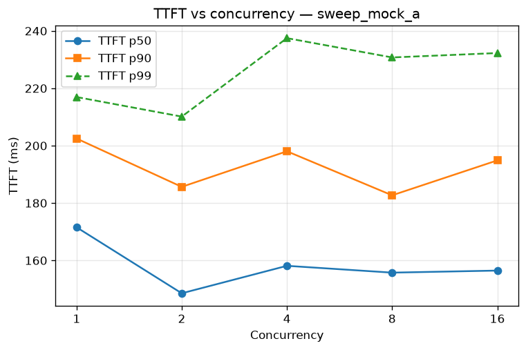
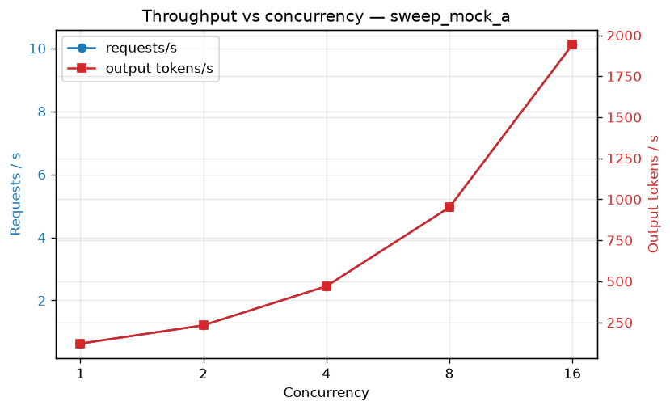
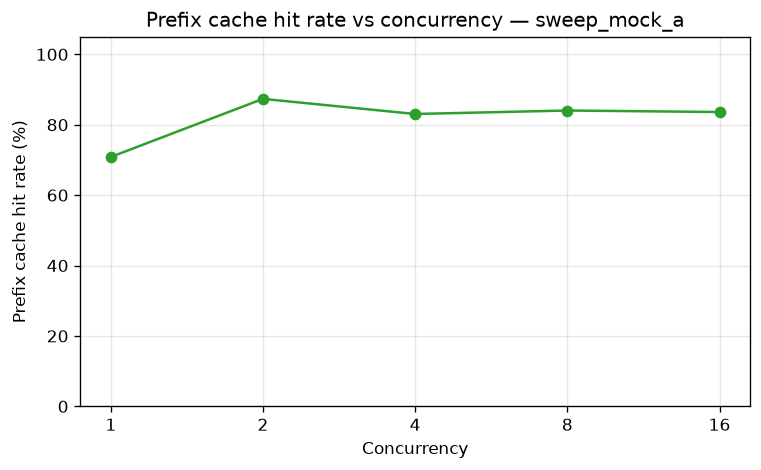
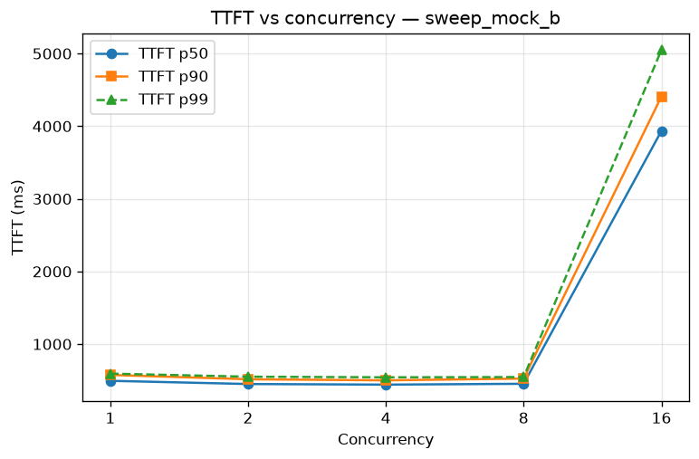
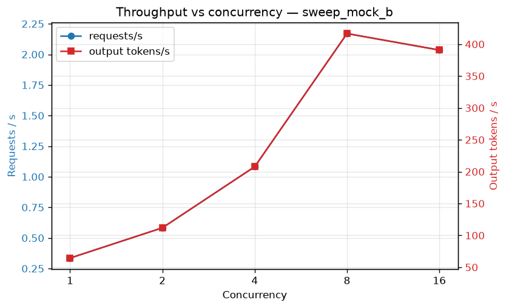
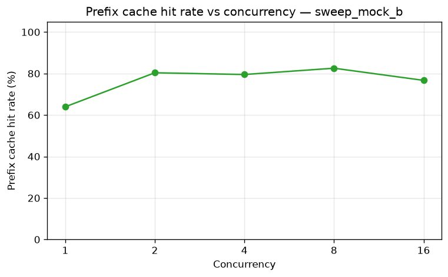
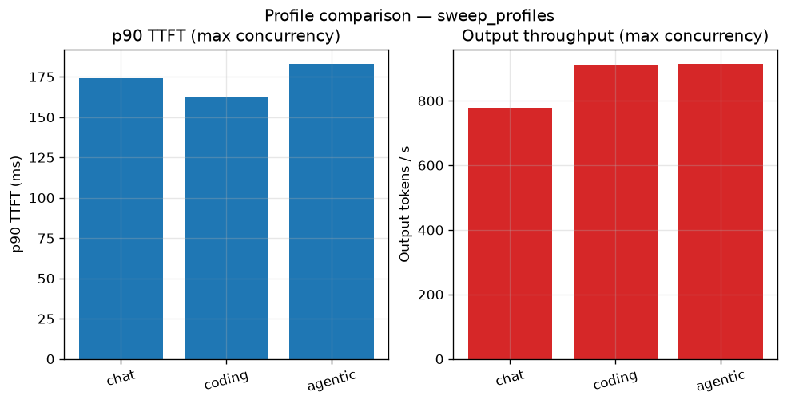
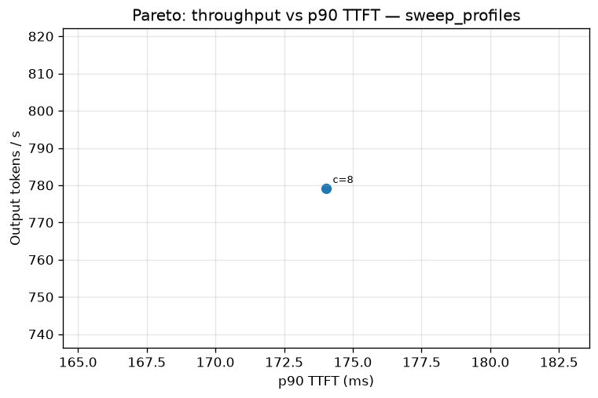
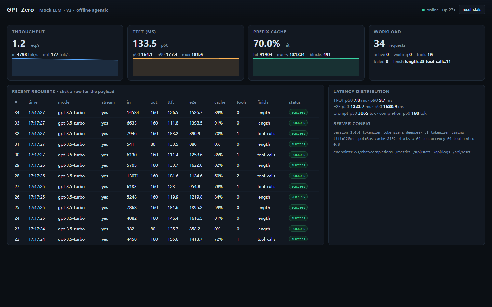

# 结果索引（真实压测产物）

所有数字都来自本机对 `gptzero` mock 的真实 HTTP 压测（`python -m bench`），
原始 JSON 与图表同目录，可用 `python -m bench report results/<name>.json` 从 JSON 重建表格与图。

> 服务端：本机 Windows / Python 3.11 / uvicorn 单进程，已启用 1ms 高精度定时器
> （`timer : 1ms high-resolution timer enabled`）——否则 Windows 默认 ~15.6ms 定时器会把
> 8ms 的 TPOT 放大或造成帧突发，读数不可信。

## 1. `sweep_mock_a` — 低延迟、64 并发槽位

服务端：`--ttft-ms 120 --tpot-ms 8 --max-concurrency 64`；profile=`coding`；每点 15s，warmup 3。

| 并发 | 请求/成功 | TTFT p50/p90/p99 (ms) | TPOT p50 (ms) | ITL p50 (ms) | E2E p50 (ms) | RPS | 输出 tok/s | Cache Hit |
|---|---|---|---|---|---|---|---|---|
| 1 | 10 / 10 | 172 / 202 / 217 | 8.1 | 23.1 | 1708 | 0.63 | 121 | 70.8% |
| 2 | 19 / 19 | 149 / 186 / 210 | 8.5 | 20.4 | 1751 | 1.21 | 232 | 87.3% |
| 4 | 40 / 40 | 158 / 198 / 238 | 8.2 | 18.8 | 1736 | 2.45 | 471 | 83.1% |
| 8 | 82 / 82 | 156 / 183 / 231 | 7.7 | 17.3 | 1642 | 4.95 | 951 | 84.0% |
| 16 | 168 / 168 | 156 / 195 / 232 | 7.4 | 16.3 | 1568 | 10.12 | 1942 | 83.6% |

**读法**：并发 1→16，RPS 0.63→10.12（×16），TTFT 几乎不涨（未触达 64 槽位），TPOT 稳定在配置值
8ms 附近——说明服务端在“算力充足”区；吞吐线性说明瓶颈在客户端会话节奏而非服务端。







## 2. `sweep_mock_b` — 高延迟、8 并发槽位（制造排队）

服务端：`--ttft-ms 400 --tpot-ms 18 --max-concurrency 8`；profile=`coding`；每点 15s。

| 并发 | 请求/成功 | TTFT p50/p90/p99 (ms) | TPOT p50 (ms) | ITL p50 (ms) | E2E p50 (ms) | RPS | 输出 tok/s | Cache Hit |
|---|---|---|---|---|---|---|---|---|
| 1 | 5 / 5 | 495 / 576 / 594 | 12.6 | 22.2 | 2869 | 0.34 | 64 | 63.9% |
| 2 | 9 / 9 | 451 / 516 / 551 | 16.2 | 34.3 | 3557 | 0.58 | 112 | 80.4% |
| 4 | 19 / 19 | 442 / 501 / 543 | 15.8 | 33.8 | 3529 | 1.08 | 208 | 79.5% |
| 8 | 38 / 38 | 454 / 526 / 546 | 15.9 | 33.8 | 3446 | 2.17 | 417 | 82.6% |
| 16 ⚠ | 45 / 45 | **3935 / 4408 / 5049** | 17.0 | 37.4 | 6983 | 2.04 | 391 | 76.7% |

**读法**：并发 16 > 槽位 8，TTFT p50 从 ~450ms 跳到 **3935ms**，RPS 不再增长（2.17→2.04）——
这正是“排队”而不是“算得更慢”：`/api/stats` 的 `waiting_requests` 与队列时间能对上。
这就是 mock 用来复现“容量拐点”的方式。







## 3. `sweep_profiles` — chat / coding / agentic 同并发对比

服务端同上（a 组参数），并发固定 8，每点 8s。

| profile | 请求/成功 | TTFT p50/p90/p99 (ms) | TPOT p50 | E2E p50 | RPS | 输出 tok/s | Cache Hit |
|---|---|---|---|---|---|---|---|
| chat | 44 / 44 | 142 / 174 / 188 | 8.6 | 1514 | 4.87 | 779 | 69.1% |
| coding | 47 / 47 | 144 / 162 / 181 | 7.5 | 1592 | 4.75 | 911 | 97.6% |
| agentic | 58 / 58 | 157 / 183 / 222 | 7.8 | 1378 | 6.03 | 914 | 70.7% |

**读法**：`coding` 的长 system 前缀 + 工具 schema 让缓存命中最高（97.6%）；`agentic` 因每轮新增
工具结果与随机工具调用，前缀被打断更多（70.7%），但请求数最多（子请求扇出）。三条曲线的差距
就是“负载形状”本身，而不是模型差异。





## 4. 复现

```powershell
# A 组
.venv\Scripts\python.exe -m bench serve-sweep --launch-server --port 8090 `
  --ttft-ms 120 --tpot-ms 8 --max-concurrency 64 `
  --profiles coding --concurrency 1,2,4,8,16 --duration 15 --name sweep_mock_a

# B 组
.venv\Scripts\python.exe -m bench serve-sweep --launch-server --port 8093 `
  --ttft-ms 400 --tpot-ms 18 --max-concurrency 8 `
  --profiles coding --concurrency 1,2,4,8,16 --duration 15 --name sweep_mock_b
```

## 5. 数据可信度

- 每个并发点都校验 `/api/config` 与首点一致（不一致直接 fail），并记录 `config_unverified`；
- ITL/TPOT 与服务端配置对账：`sweep_mock_a` TPOT 7.4–8.5ms（配置 8）、`sweep_mock_b` 15.8–17.0ms（配置 18）；
- 失败率 0%，所有点 `valid=true`；
- 早期一版 `sweep_mock_a`（17:05）因 Windows 定时器精度导致 ITL p50=0.1ms，已被 17:13 的重跑替换；
  `bench/` 里保留了按点配置自检，防止这类问题静默通过。

## 6. 文件

```
results/
  sweep_mock_a.{json,md,csv}   charts/sweep_mock_a/*.{png,svg}
  sweep_mock_b.{json,md,csv}   charts/sweep_mock_b/*.{png,svg}
  sweep_profiles.{json,md,csv} charts/sweep_profiles/*.{png,svg}
  charts/dashboard.png         管理面板实拍（压测运行中）
  compose-bench.json           容器内 compose 压测（ops 交付验证）
```


