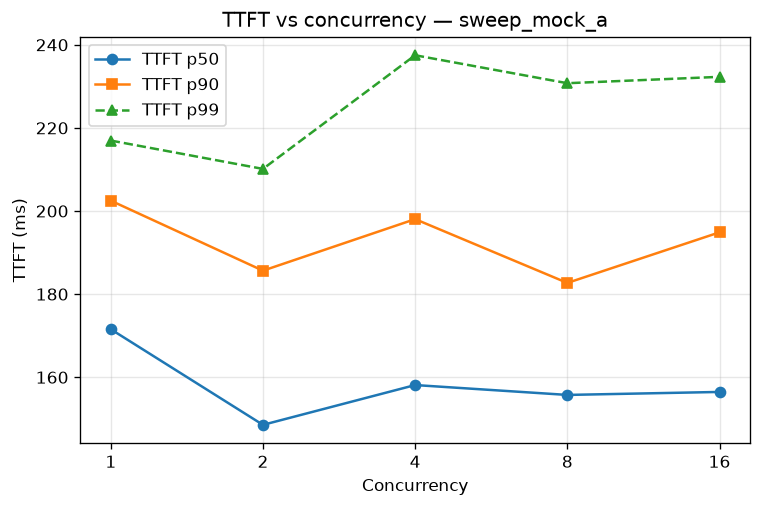
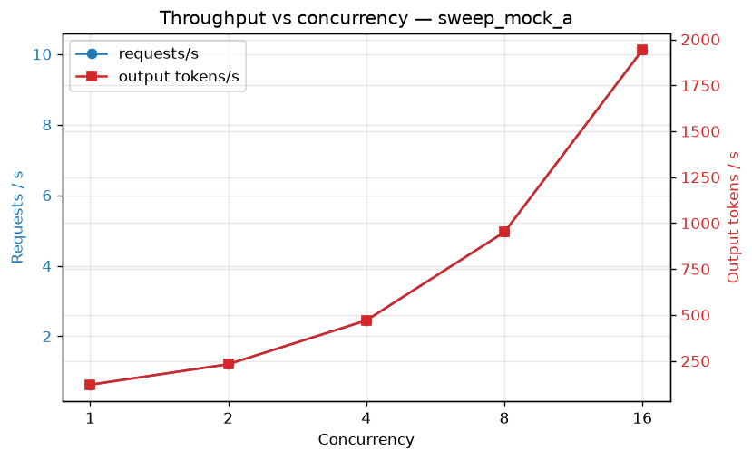
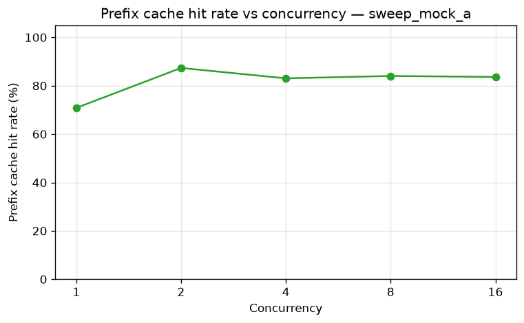
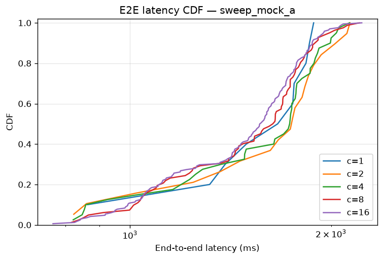
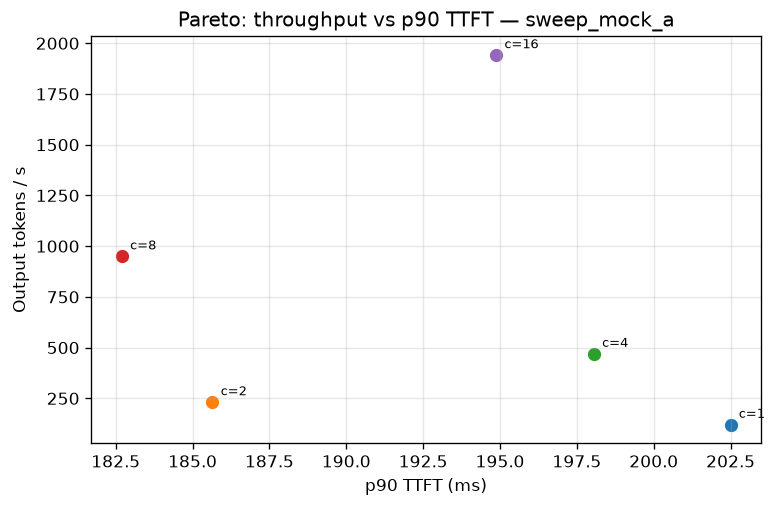
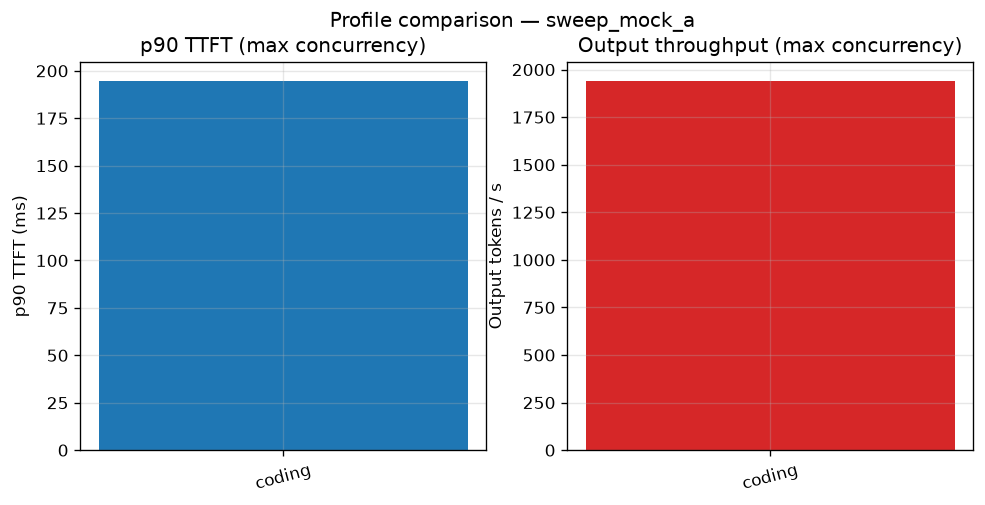

# GPT-Zero 压测报告 — sweep_mock_a

- 生成时间：2026-10-28T17:10:56+08:00
- 服务地址：`http://127.0.0.1:8090`
- 模型：`gpt-3.5-turbo`
- 工具：gptzero-bench 0.1.0

## 1. 服务端配置（模拟硬件参数）

| 参数 | 值 | 含义 |
|---|---|---|
| `ttft_ms` | 120.0 | 基础首 token 延迟（不含排队/预填充放大） |
| `tpot_ms` | 8.0 | 每个输出 token 的解码时间 |
| `max_concurrency` | 64 | 服务端并发槽位；超出后请求排队，TTFT 抬升 |
| `block_size` | 64 | prefix cache 块大小（token） |
| `cache_blocks` | 8192 | prefix cache 容量（块） |
| `tokenizer` | tokenizers:deepseek_v3_tokenizer | 服务端 token 计数实现 |

配置一致性：✅ 所有测量点的 `/api/config` 与首点一致

### 按点 `/api/config` 校验与计时自检

| 并发 | profile | ttft_ms | tpot_ms | max_concurrency | 配置一致 | 预热探针 RTT p50 (ms) | 实测 TPOT p50 (ms) | 状态 |
|---|---|---|---|---|---|---|---|---|
| 1 | coding | 120.0 | 8.0 | 64 | 是 | 399 | 8.07 | OK |
| 2 | coding | 120.0 | 8.0 | 64 | 是 | 395 | 8.45 | OK |
| 4 | coding | 120.0 | 8.0 | 64 | 是 | 399 | 8.17 | OK |
| 8 | coding | 120.0 | 8.0 | 64 | 是 | 395 | 7.69 | OK |
| 16 | coding | 120.0 | 8.0 | 64 | 是 | 400 | 7.38 | OK |

## 2. 压测配置

| 参数 | 值 |
|---|---|
| profiles | coding |
| concurrency | 1, 2, 4, 8, 16 |
| duration_s | 15.0 |
| warmup | 3 |
| seed | 42 |
| max_tokens | 按 profile 默认 |

## 3.1 profile `coding`

| 并发 | 请求数 | 成功率 | TTFT p50 (ms) | TTFT p90 (ms) | TTFT p99 (ms) | TPOT p50 (ms) | ITL p50 (ms) | E2E p50 (ms) | E2E p90 (ms) | E2E p99 (ms) | RPS | 输入 tok/s | 输出 tok/s | Cache Hit |
|---|---|---|---|---|---|---|---|---|---|---|---|---|---|---|
| 1 | 10 | 100.0% | 171.6 | 202.5 | 217.0 | 8.1 | 23.1 | 1708.2 | 1859.5 | 1881.2 | 0.63 | 4994.1 | 121.0 | 70.8% |
| 2 | 19 | 100.0% | 148.5 | 185.6 | 210.1 | 8.5 | 20.4 | 1751.4 | 2042.1 | 2130.7 | 1.21 | 9280.4 | 232.4 | 87.3% |
| 4 | 40 | 100.0% | 158.1 | 198.0 | 237.5 | 8.2 | 18.8 | 1735.7 | 1995.9 | 2101.1 | 2.45 | 20139.7 | 470.6 | 83.1% |
| 8 | 82 | 100.0% | 155.7 | 182.7 | 230.8 | 7.7 | 17.3 | 1642.0 | 1893.2 | 2133.0 | 4.95 | 38933.2 | 950.9 | 84.0% |
| 16 | 168 | 100.0% | 156.5 | 194.9 | 232.3 | 7.4 | 16.3 | 1568.4 | 1874.5 | 2074.9 | 10.12 | 76318.8 | 1942.4 | 83.6% |

该 profile 共 319 条请求；表中每行为一个独立测量点。

## 4. 图表













## 5. 结论

- 并发 1 → 16（profile `coding`）：RPS 由 0.63 提升到 10.12（+1505%）。
- TTFT p90 由 202 ms 变化到 195 ms（0.96×，基本持平）；TTFT 中包含服务端排队时间，服务端 max_concurrency=64。
- 输出吞吐由 121.0 tok/s 变化到 1942.4 tok/s，输入吞吐由 4994.1 到 76318.8 tok/s。
- 服务端 token 级 prefix cache 命中率区间为 70.8% ~ 87.3%（按并发点）。
- 所有测量点失败率为 0。
- 未观察到饱和：最后两级并发 RPS 仍提升 104.3%，TTFT p90 变化 +6.7%；本次并发范围内 mock 的 CPU 尚未成为瓶颈，继续加并发前建议先观察更高并发的 TTFT 曲线。

_数据自检：所有测量点配置一致、TPOT 与配置相符、无异常样本数。_

## 7. 复现命令

```bash
python -m bench sweep --url http://127.0.0.1:8090 --profiles coding --concurrency 1,2,4,8,16 --duration 15.0 --name sweep_mock_a
python -m bench report sweep_mock_a.json
```
