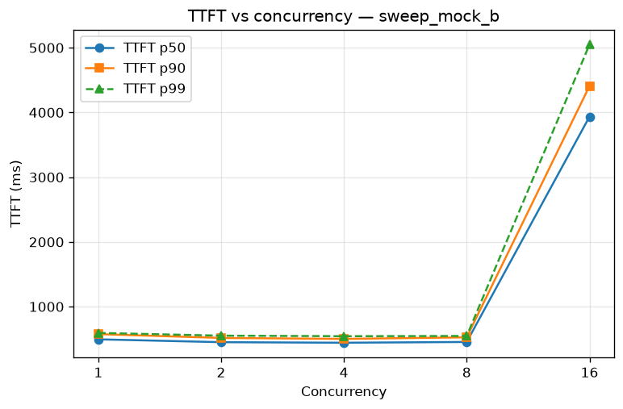
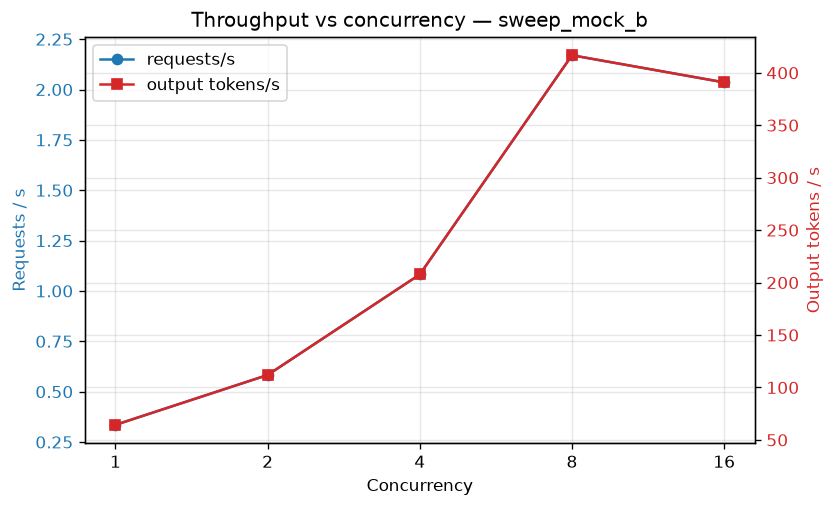
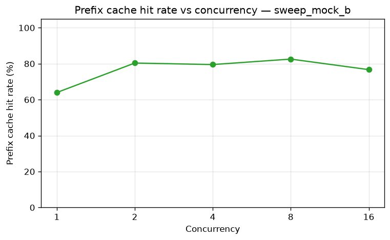
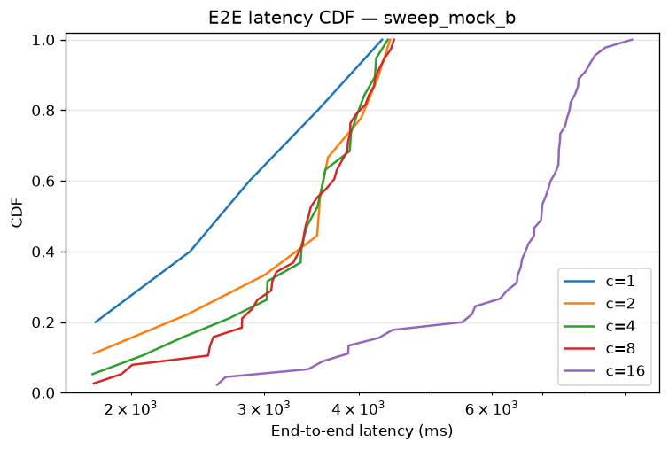
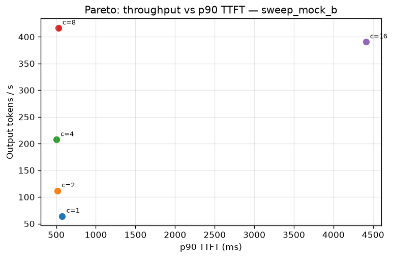
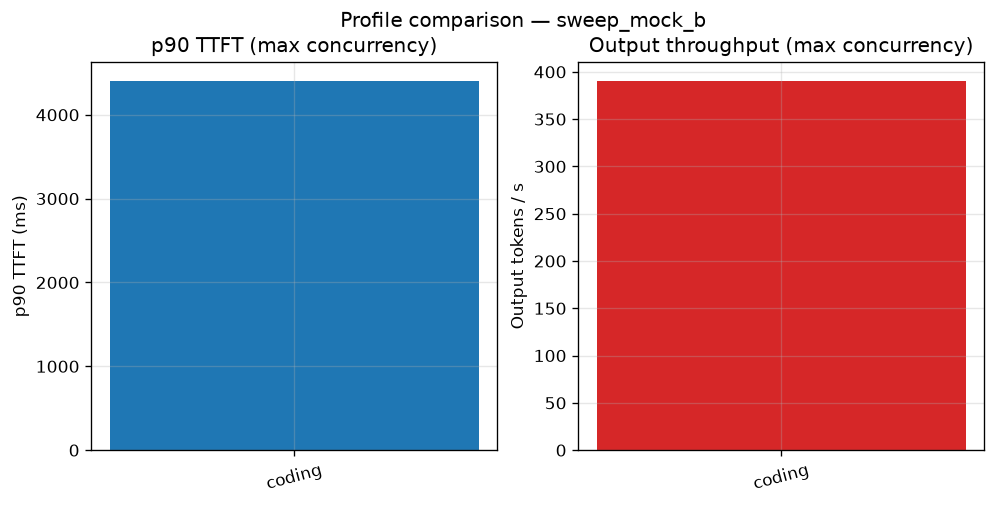

# GPT-Zero 压测报告 — sweep_mock_b

- 生成时间：2026-10-28T17:13:07+08:00
- 服务地址：`http://127.0.0.1:8093`
- 模型：`gpt-3.5-turbo`
- 工具：gptzero-bench 0.1.0

## 1. 服务端配置（模拟硬件参数）

| 参数 | 值 | 含义 |
|---|---|---|
| `ttft_ms` | 400.0 | 基础首 token 延迟（不含排队/预填充放大） |
| `tpot_ms` | 18.0 | 每个输出 token 的解码时间 |
| `max_concurrency` | 8 | 服务端并发槽位；超出后请求排队，TTFT 抬升 |
| `block_size` | 64 | prefix cache 块大小（token） |
| `cache_blocks` | 8192 | prefix cache 容量（块） |
| `tokenizer` | tokenizers:deepseek_v3_tokenizer | 服务端 token 计数实现 |

配置一致性：✅ 所有测量点的 `/api/config` 与首点一致

### 按点 `/api/config` 校验与计时自检

| 并发 | profile | ttft_ms | tpot_ms | max_concurrency | 配置一致 | 预热探针 RTT p50 (ms) | 实测 TPOT p50 (ms) | 状态 |
|---|---|---|---|---|---|---|---|---|
| 1 | coding | 400.0 | 18.0 | 8 | 是 | 973 | 12.56 | OK |
| 2 | coding | 400.0 | 18.0 | 8 | 是 | 981 | 16.21 | OK |
| 4 | coding | 400.0 | 18.0 | 8 | 是 | 975 | 15.82 | OK |
| 8 | coding | 400.0 | 18.0 | 8 | 是 | 976 | 15.88 | OK |
| 16 | coding | 400.0 | 18.0 | 8 | 是 | 968 | 17.02 | ⚠ 见下 |

## 2. 压测配置

| 参数 | 值 |
|---|---|
| profiles | coding |
| concurrency | 1, 2, 4, 8, 16 |
| duration_s | 15.0 |
| warmup | 3 |
| seed | 42 |
| max_tokens | 按 profile 默认 |

## 3.1 profile `coding`

| 并发 | 请求数 | 成功率 | TTFT p50 (ms) | TTFT p90 (ms) | TTFT p99 (ms) | TPOT p50 (ms) | ITL p50 (ms) | E2E p50 (ms) | E2E p90 (ms) | E2E p99 (ms) | RPS | 输入 tok/s | 输出 tok/s | Cache Hit |
|---|---|---|---|---|---|---|---|---|---|---|---|---|---|---|
| 1 | 5 | 100.0% | 494.9 | 575.9 | 593.8 | 12.6 | 22.2 | 2868.9 | 3990.1 | 4264.8 | 0.34 | 946.2 | 64.4 | 63.9% |
| 2 | 9 | 100.0% | 450.7 | 516.0 | 551.4 | 16.2 | 34.3 | 3557.4 | 4269.2 | 4389.1 | 0.58 | 1665.5 | 111.9 | 80.4% |
| 4 | 19 | 100.0% | 442.2 | 501.3 | 543.1 | 15.8 | 33.8 | 3528.7 | 4206.0 | 4344.0 | 1.08 | 3666.9 | 207.7 | 79.5% |
| 8 | 38 | 100.0% | 453.9 | 525.5 | 546.4 | 15.9 | 33.8 | 3446.3 | 4227.3 | 4439.4 | 2.17 | 7012.5 | 416.7 | 82.6% |
| 16 ⚠ | 45 | 100.0% | 3935.1 | 4408.1 | 5048.5 | 17.0 | 37.4 | 6982.8 | 7918.1 | 8877.0 | 2.04 | 4525.1 | 390.8 | 76.7% |

该 profile 共 116 条请求；表中每行为一个独立测量点。

## 4. 图表













## 5. 结论

- 并发 1 → 16（profile `coding`）：RPS 由 0.34 提升到 2.04（+507%）。
- TTFT p90 由 576 ms 变化到 4408 ms（7.65×，上升）；TTFT 中包含服务端排队时间，服务端 max_concurrency=8。
- 输出吞吐由 64.4 tok/s 变化到 390.8 tok/s，输入吞吐由 946.2 到 4525.1 tok/s。
- 服务端 token 级 prefix cache 命中率区间为 63.9% ~ 82.6%（按并发点）。
- 所有测量点失败率为 0。
- 服务端并发槽位为 8，最后测量点并发 16 已超出槽位；此时 TTFT 中相当一部分是排队等待，而不是 mock 的计算时间。
- **饱和信号**：最后两级并发 RPS 仅提升 -6.2%，而 TTFT p90 上升 738.8%——继续加并发只增加排队，不增加吞吐。

### 5.1 数据自检与提示（异常点已标注）

- ⚠ 并发 16 / `coding`：并发 16 超过服务端槽位 8，TTFT 包含排队时间

## 7. 复现命令

```bash
python -m bench sweep --url http://127.0.0.1:8093 --profiles coding --concurrency 1,2,4,8,16 --duration 15.0 --name sweep_mock_b
python -m bench report sweep_mock_b.json
```
