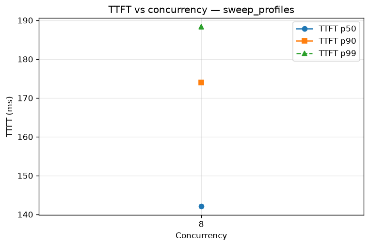
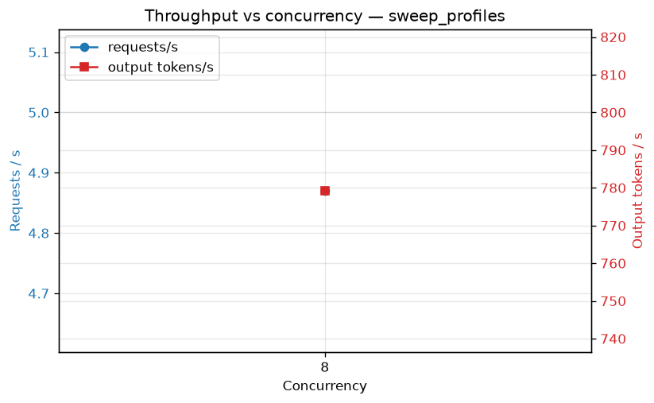
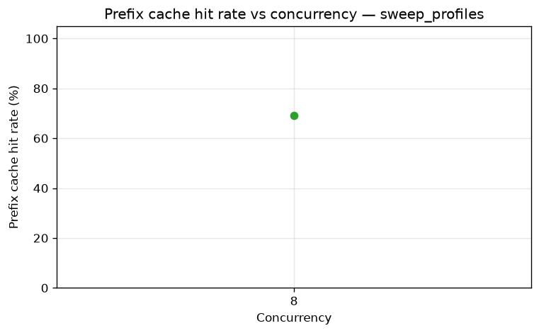
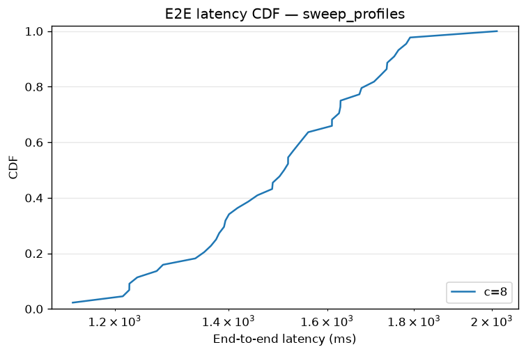
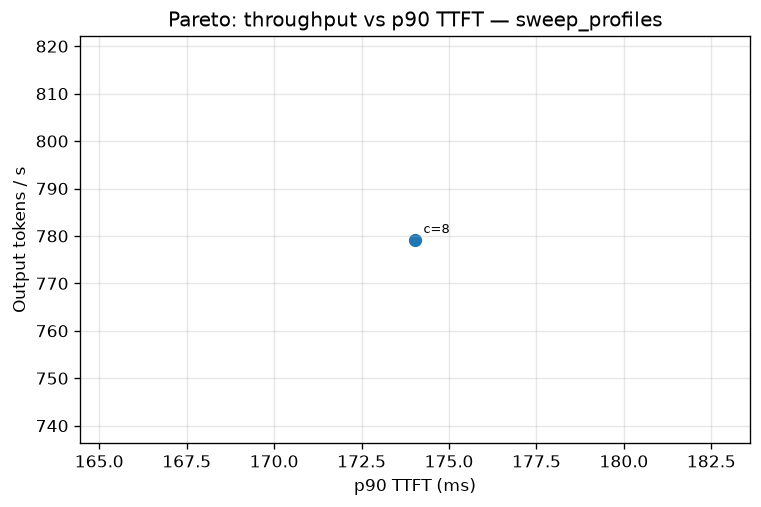
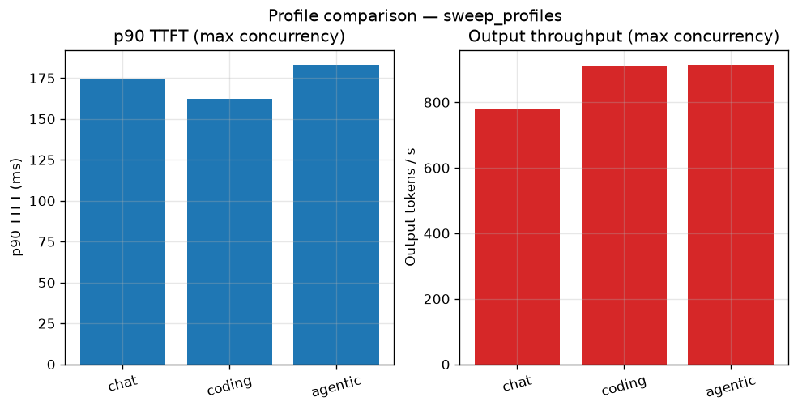

# GPT-Zero 压测报告 — sweep_profiles

- 生成时间：2026-10-28T17:14:12+08:00
- 服务地址：`http://127.0.0.1:8090`
- 模型：`gpt-3.5-turbo`
- 工具：gptzero-bench 0.1.0

## 1. 服务端配置（模拟硬件参数）

| 参数 | 值 | 含义 |
|---|---|---|
| `ttft_ms` | 120.0 | 基础首 token 延迟（不含排队/预填充放大） |
| `tpot_ms` | 8.0 | 每个输出 token 的解码时间 |
| `max_concurrency` | 64 | 服务端并发槽位；超出后请求排队，TTFT 抬升 |
| `block_size` | 64 | prefix cache 块大小（token） |
| `cache_blocks` | 8192 | prefix cache 容量（块） |
| `tokenizer` | tokenizers:deepseek_v3_tokenizer | 服务端 token 计数实现 |

配置一致性：✅ 所有测量点的 `/api/config` 与首点一致

### 按点 `/api/config` 校验与计时自检

| 并发 | profile | ttft_ms | tpot_ms | max_concurrency | 配置一致 | 预热探针 RTT p50 (ms) | 实测 TPOT p50 (ms) | 状态 |
|---|---|---|---|---|---|---|---|---|
| 8 | chat | 120.0 | 8.0 | 64 | 是 | 403 | 8.59 | OK |
| 8 | coding | 120.0 | 8.0 | 64 | 是 | 398 | 7.53 | OK |
| 8 | agentic | 120.0 | 8.0 | 64 | 是 | 397 | 7.81 | OK |

## 2. 压测配置

| 参数 | 值 |
|---|---|
| profiles | chat, coding, agentic |
| concurrency | 8 |
| duration_s | 8.0 |
| warmup | 2 |
| seed | 42 |
| max_tokens | 按 profile 默认 |

## 3.1 profile `chat`

| 并发 | 请求数 | 成功率 | TTFT p50 (ms) | TTFT p90 (ms) | TTFT p99 (ms) | TPOT p50 (ms) | ITL p50 (ms) | E2E p50 (ms) | E2E p90 (ms) | E2E p99 (ms) | RPS | 输入 tok/s | 输出 tok/s | Cache Hit |
|---|---|---|---|---|---|---|---|---|---|---|---|---|---|---|
| 8 | 44 | 100.0% | 142.1 | 174.0 | 188.3 | 8.6 | 16.8 | 1513.5 | 1747.3 | 1917.6 | 4.87 | 2748.2 | 779.2 | 69.1% |

该 profile 共 44 条请求；表中每行为一个独立测量点。

## 3.2 profile `coding`

| 并发 | 请求数 | 成功率 | TTFT p50 (ms) | TTFT p90 (ms) | TTFT p99 (ms) | TPOT p50 (ms) | ITL p50 (ms) | E2E p50 (ms) | E2E p90 (ms) | E2E p99 (ms) | RPS | 输入 tok/s | 输出 tok/s | Cache Hit |
|---|---|---|---|---|---|---|---|---|---|---|---|---|---|---|
| 8 | 47 | 100.0% | 144.3 | 162.4 | 180.9 | 7.5 | 17.8 | 1591.5 | 1858.6 | 2150.3 | 4.75 | 19179.2 | 911.1 | 97.6% |

该 profile 共 47 条请求；表中每行为一个独立测量点。

## 3.3 profile `agentic`

| 并发 | 请求数 | 成功率 | TTFT p50 (ms) | TTFT p90 (ms) | TTFT p99 (ms) | TPOT p50 (ms) | ITL p50 (ms) | E2E p50 (ms) | E2E p90 (ms) | E2E p99 (ms) | RPS | 输入 tok/s | 输出 tok/s | Cache Hit |
|---|---|---|---|---|---|---|---|---|---|---|---|---|---|---|
| 8 | 58 | 100.0% | 156.6 | 183.0 | 222.4 | 7.8 | 13.9 | 1378.0 | 1590.4 | 1718.5 | 6.03 | 23831.0 | 914.5 | 70.7% |

该 profile 共 58 条请求，其中子请求 6 条（agentic 含 20% 概率的并行 subagent 子请求）；表中每行为一个独立测量点。

## 4. 图表













## 5. 结论

- 并发 8 → 8（profile `chat`）：RPS 由 4.87 提升到 4.87（+0%）。
- TTFT p90 由 174 ms 变化到 174 ms（1.00×，基本持平）；TTFT 中包含服务端排队时间，服务端 max_concurrency=64。
- 输出吞吐由 779.2 tok/s 变化到 779.2 tok/s，输入吞吐由 2748.2 到 2748.2 tok/s。
- 服务端 token 级 prefix cache 命中率区间为 69.1% ~ 69.1%（按并发点）。
- 所有测量点失败率为 0。

_数据自检：所有测量点配置一致、TPOT 与配置相符、无异常样本数。_

## 7. 复现命令

```bash
python -m bench sweep --url http://127.0.0.1:8090 --profiles chat,coding,agentic --concurrency 8 --duration 8.0 --name sweep_profiles
python -m bench report sweep_profiles.json
```
